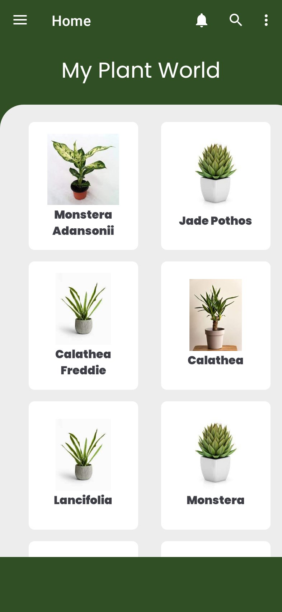
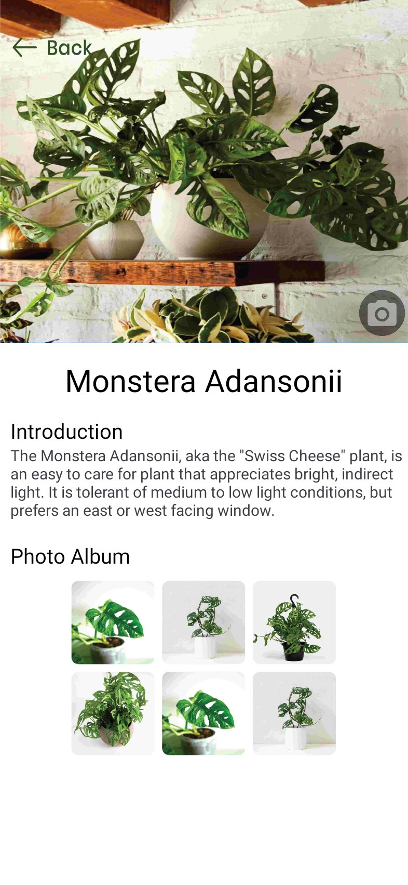
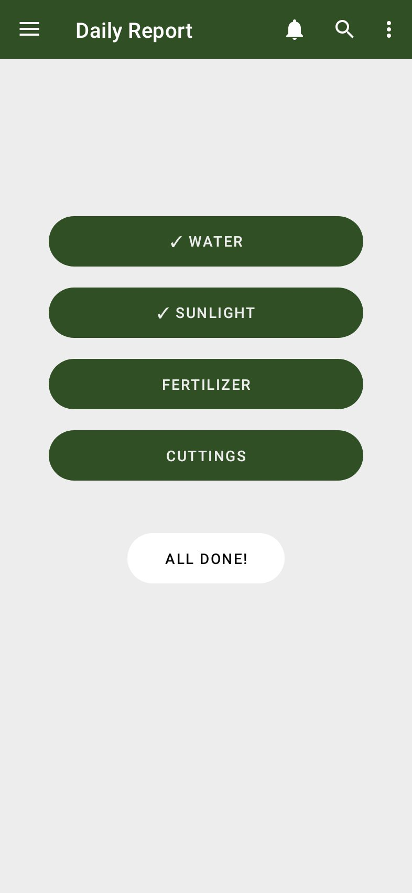
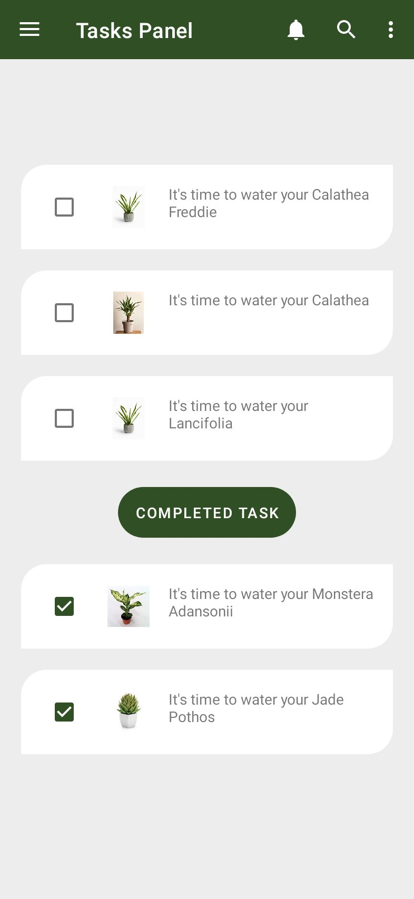
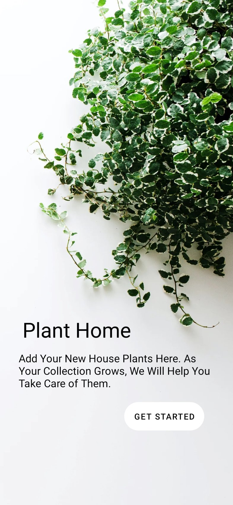
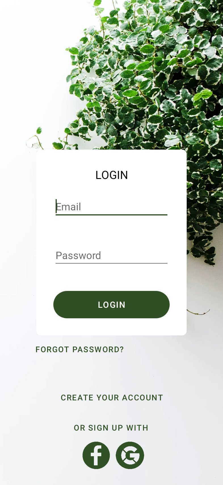
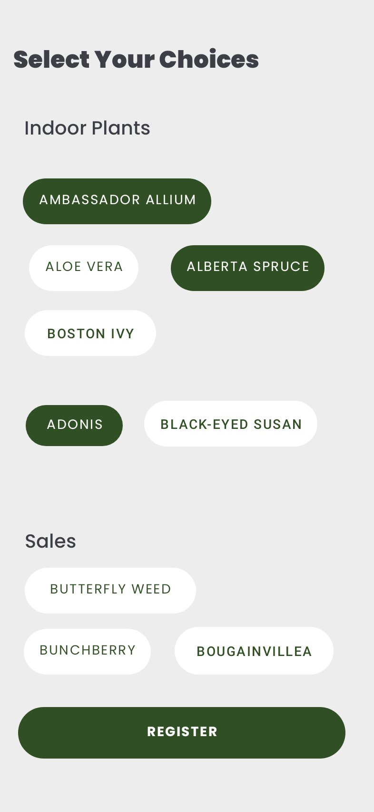
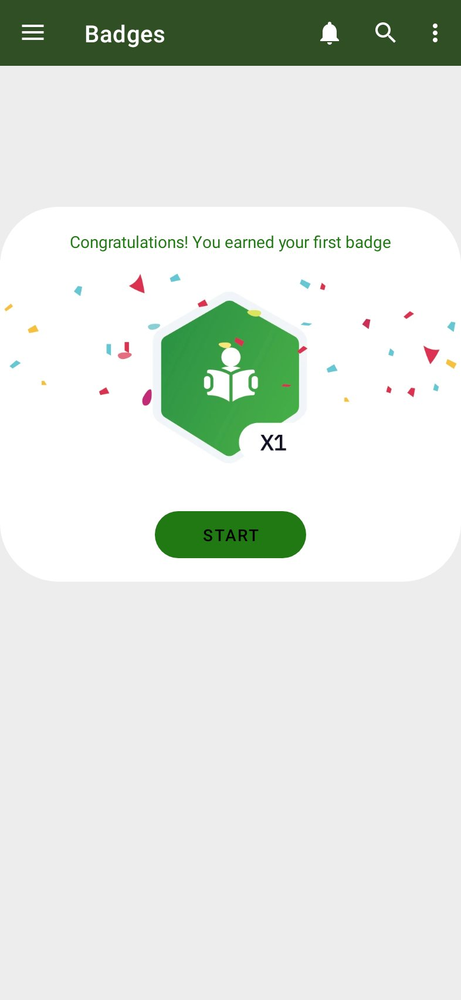

# PlantsHome

A plant care diary for Android. Keep your houseplants in one place, read how to look after each one, tick off today's watering and care, and earn a badge for every day you finish.

Built in Java with Firebase Authentication, AndroidX Navigation and WorkManager.

I designed and built PlantsHome as my semester project in 2021. In 2026 I brought it up to date without changing the design: a current SDK and build tools, every screen working end to end, tests, CI and a release pipeline.

[](https://github.com/Shahryartariq/plantshome/actions/workflows/android.yml)

## Screenshots

| Home | Plant page | Daily Report | Tasks |
| --- | --- | --- | --- |
|  |  |  |  |

| Get Started | Login | Choices | Badge |
| --- | --- | --- | --- |
|  |  |  |  |

The screenshots are rendered from the app's real layouts by [`ScreenshotTest`](app/src/test/java/com/example/plantshome/ScreenshotTest.java) (Robolectric). See [CI](#ci) to regenerate them.

## Features

- **My Plant World:** your plants in a grid. Search them from the toolbar.
- **Plant pages:** care notes for each plant (light, watering, humidity), plus a photo album you fill with the camera.
- **Daily Report:** tick Water, Sunlight, Fertilizer and Cuttings as you do them. Progress is saved for the day.
- **Tasks:** plants that need watering. Ticked tasks move under "Completed Task".
- **Badges:** finish the day's care to earn a badge. The badge screen keeps count.
- **Daily reminder:** an optional notification at 9:00 (the bell in the toolbar).
- **Accounts:** sign up with email and password or continue with Google, then verify your email. You can also reset a forgotten password, change your email or password, set a profile photo, and delete your account along with its data.
- **Onboarding:** splash screen, Get Started, then a one-time plant choices screen.
- **Drawer:** profile, feedback (opens your email app), rate, share and logout.

## Tech stack

| Area | Choice |
| --- | --- |
| Language | Java 17 |
| UI | XML layouts, ViewBinding, Material Components, ConstraintLayout, edge-to-edge |
| Navigation | AndroidX Navigation (drawer + fragments) |
| Auth | Firebase Authentication: email/password and Google (Credential Manager) |
| Background work | WorkManager (daily reminder) |
| Storage | SharedPreferences per account; photos in app-private storage via FileProvider |
| Build | Gradle 8.14, Android Gradle Plugin 8.13, version catalog, Dependabot |
| SDK | minSdk 23, targetSdk / compileSdk 36 |
| Release | R8 + resource shrinking, signing from environment variables, GitHub Releases |
| Tests | JUnit, Robolectric (logic and screenshot rendering), Android Lint |

## Project structure

```
app/src/main/java/com/example/plantshome/
├── BaseActivity.java          edge-to-edge handling shared by every screen
├── SplashActivity.java        → Get Started, or straight in if already signed in
├── LoginActivity.java / SignupActivity.java / VerifyEmailActivity.java
├── ChoicesActivity.java       one-time plant picker
├── MainActivity.java          toolbar (search, reminder) + navigation drawer host
├── PlantDetailActivity.java   care notes + camera photo album
├── ProfileActivity.java / ResetPasswordActivity.java / ThanksActivity.java
├── auth/                      Google sign-in
├── data/                      plant catalog, daily care log, photos
├── reminder/                  daily reminder (WorkManager)
├── ui/                        drawer screens: home, report, taskpanel, badge, feedback
└── util/                      validation, Firebase error messages, navigation and intent helpers
```

## Run it locally

1. Install [Android Studio](https://developer.android.com/studio) (it bundles JDK 17).
2. Clone the repo:
   ```bash
   git clone https://github.com/Shahryartariq/plantshome.git
   cd plantshome
   ```
3. Add your Firebase config. It is not in the repo on purpose.
   1. In the [Firebase console](https://console.firebase.google.com/), create a project, or open an existing one.
   2. Add an Android app with the package name `com.example.plantshome`.
   3. Under **Authentication → Sign-in method**, turn on **Email/Password**.
   4. Optional, for "Continue with Google": turn on **Google** there too, and add your debug key's SHA-1 to the Android app (`./gradlew signingReport` prints it).
   5. Download `google-services.json` (after the steps above) and put it in the `app/` folder.
4. Open the project in Android Studio and run it on a device or emulator (Android 6.0 or newer).

Command line:

```bash
./gradlew assembleDebug         # build the debug APK
./gradlew testDebugUnitTest     # unit tests
./gradlew lintDebug             # Android Lint
```

## Release build

The release build is minified with R8. Signing details come from environment variables, or from `~/.gradle/gradle.properties`, and are never committed:

```properties
PLANTSHOME_KEYSTORE_FILE=/path/to/release.jks
PLANTSHOME_KEYSTORE_PASSWORD=...
PLANTSHOME_KEY_ALIAS=...
PLANTSHOME_KEY_PASSWORD=...
```

```bash
./gradlew bundleRelease         # app bundle for Google Play
```

Play Store listing text lives in [`fastlane/metadata/android/en-US`](fastlane/metadata/android/en-US).

## CI

| Workflow | When | What |
| --- | --- | --- |
| [`android.yml`](.github/workflows/android.yml) | every push to `main` and every pull request | debug and release builds, Lint, unit tests, debug APK artifact |
| [`release.yml`](.github/workflows/release.yml) | a pushed tag like `v1.2.0` | builds the app and attaches it to a GitHub Release (signed AAB too when the keystore secrets are set) |
| [`screenshots.yml`](.github/workflows/screenshots.yml) | a pushed branch named `screenshots/…` | renders the README screenshots and commits them to that branch |

CI uses the `GOOGLE_SERVICES_JSON` repository secret when it is set. Without it, CI builds against a placeholder config that compiles but can't sign in. `release.yml` requires the secret.

## Privacy

Plant photos and progress stay on the phone. There are no ads and no tracking. See [PRIVACY.md](PRIVACY.md) and [SECURITY.md](SECURITY.md).
